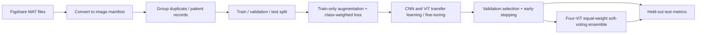

# Brain Tumor Classification: CNNs and Vision Transformers

A reproducible PyTorch comparative study of transfer learning and fine-tuning for three-class brain tumor MRI classification. The project benchmarks three CNNs against four Vision Transformers (ViTs), evaluates models with class-balanced metrics, and implements an equal-weight ViT soft-voting ensemble.

> **Research status (October 2026):** Validation and held-out test results are reported for all three CNNs, all four ViTs, and the four-model ViT ensemble. Macro and class-wise precision/recall are included to make the comparison informative for the imbalanced classes.


*Illustrative MRI slices from the original project assets; this is not a model prediction or an evaluation figure.*

## Study question

How do established CNN architectures and ImageNet-pretrained ViT architectures compare on the same Figshare brain tumor dataset when fine-tuned with a consistent, leakage-conscious split and selected using validation accuracy, macro precision, and macro recall?

### Models in the comparison

| Family | Models | Status |
|---|---|---|
| CNN | VGG16, MobileNetV2, EfficientNet-B3 | Trained and evaluated on validation and held-out test splits. |
| ViT | ViT-B/16, ViT-B/32, ViT-L/16, ViT-L/32 | Trained and evaluated on validation and held-out test splits. |
| Ensemble | Equal-weight soft voting across the four ViTs | Evaluated on validation and held-out test splits. |

MobileNetV2 is the specific torchvision model used for the “MobileNet” comparison. The CNN model shortlist is motivated by a published brain MRI CNN comparison that identifies EfficientNetB3 and MobileNet among its top performers and also reports VGG16 results.

## Results

The following values come from the project's generated comparison reports. Percentages are rounded to two decimal places. The validation selection score is the unweighted mean of validation accuracy, macro precision, and macro recall; it is used for checkpoint selection. Macro metrics give each class equal weight.

### Validation results

| Model | Selected epoch | Accuracy | Macro precision | Macro recall | Macro F1 | Selection score |
|---|---:|---:|---:|---:|---:|---:|
| MobileNetV2 | 9 | 99.10% | 99.00% | 99.13% | 99.06% | **99.07%** |
| EfficientNet-B3 | 4 | 98.80% | 98.86% | 98.74% | 98.79% | 98.80% |
| ViT four-model ensemble (224) | — | 98.80% | 98.77% | 98.88% | — | 98.81% |
| ViT-B/32 (224) | 13 | 98.19% | 97.96% | 98.33% | 98.13% | 98.16% |
| VGG16 | 16 | 97.89% | 97.76% | 97.95% | 97.85% | 97.87% |
| ViT-L/16 (224) | 13 | 96.99% | 97.04% | 97.07% | 97.05% | 97.03% |
| ViT-L/32 (224) | 6 | 96.69% | 96.79% | 96.61% | 96.68% | 96.70% |
| ViT-B/16 (224) | 20 | 96.39% | 96.31% | 96.31% | 96.31% | 96.33% |

### Held-out test results

| Model | Accuracy | Balanced accuracy | Macro precision | Macro recall | Macro F1 |
|---|---:|---:|---:|---:|---:|
| ViT-B/16 (224) | **92.43%** | **92.81%** | **91.52%** | **92.81%** | **91.97%** |
| ViT four-model ensemble (224) | 91.45% | 91.69% | 89.86% | 91.69% | 90.49% |
| ViT-B/32 (224) | 89.80% | 90.43% | 88.12% | 90.43% | 88.77% |
| ViT-L/32 (224) | 89.14% | 88.19% | 87.27% | 88.19% | 87.65% |
| MobileNetV2 | 88.16% | 89.63% | 87.57% | 89.63% | 87.37% |
| EfficientNet-B3 | 87.50% | 88.13% | 85.70% | 88.13% | 86.26% |
| ViT-L/16 (224) | 86.51% | 85.38% | 84.85% | 85.38% | 84.95% |
| VGG16 | 83.88% | 84.06% | 84.10% | 84.06% | 82.70% |

### Per-class test precision / recall

| Model | Glioma P / R | Meningioma P / R | Pituitary P / R |
|---|---:|---:|---:|
| VGG16 | 87.92% / 87.33% | 67.42% / 93.75% | 96.97% / 71.11% |
| MobileNetV2 | 96.27% / 86.00% | 67.74% / 98.44% | 98.70% / 84.44% |
| EfficientNet-B3 | 96.99% / 86.00% | 68.24% / 90.62% | 91.86% / 87.78% |
| ViT-B/16 (224) | 94.52% / 92.00% | 82.43% / 95.31% | 97.62% / 91.11% |
| ViT-B/32 (224) | 97.06% / 88.00% | 71.95% / 92.19% | 95.35% / 91.11% |
| ViT-L/16 (224) | 90.54% / 89.33% | 71.23% / 81.25% | 92.77% / 85.56% |
| ViT-L/32 (224) | 93.10% / 90.00% | 73.24% / 81.25% | 95.45% / 93.33% |
| ViT four-model ensemble (224) | 96.45% / 90.67% | 76.62% / 92.19% | 96.51% / 92.22% |

P = precision; R = recall. The test table ranks ViT-B/16 highest on accuracy, balanced accuracy, macro precision, macro recall, and macro F1 among these reported runs. The class-wise table shows why aggregate accuracy alone is insufficient: meningioma precision is lower than recall for every model, so false-positive behavior for that class merits attention. The ensemble improves over most individual ViTs but does not exceed ViT-B/16 on these test metrics.

## Data and leakage controls

The study uses the [Figshare brain tumor dataset](https://figshare.com/articles/dataset/brain_tumor_dataset/1512427), containing 3,064 T1-weighted contrast-enhanced images labeled as meningioma (708), glioma (1,426), or pituitary tumor (930). Raw images are converted from the dataset's MATLAB `.mat` format to PNG and recorded in a manifest.

The earlier notebook had an important evaluation risk: it generated augmented images before splitting the dataset. A transformed copy could therefore land in a different split from its source image, making test results overly optimistic. It also split without subject grouping. Its historical metrics and plots are intentionally not presented here as evidence for the refactored models. The replacement Colab notebook follows the current pipeline.

The current preparation code splits before augmentation, then applies random augmentation only to the training dataset. It groups records by `cjdata.PID` when present and also groups byte-identical images. Validation and test transformations are deterministic. **Limitation:** exact-duplicate grouping is not a near-duplicate detector; if usable patient IDs are absent, this pipeline cannot guarantee subject-level independence.

## Method

1. Convert MAT files and prepare deterministic, class-aware train/validation/test manifests (80/10/10 target ratios at the independent group level).
2. Initialize CNNs and ViTs from ImageNet-pretrained weights; train the classification head and backbone end-to-end (the current configs do not use a frozen-backbone warm-up stage).
3. Use train-only image augmentation and inverse-frequency class-weighted cross-entropy.
4. Monitor validation accuracy, macro precision, and macro recall. Select checkpoints by their mean; use `ReduceLROnPlateau` and early stopping (patience 6 epochs).
5. Once training is complete, evaluate each selected checkpoint on the held-out test split and report accuracy, balanced accuracy, macro/weighted precision and recall, F1, confusion matrix, and per-class metrics.
6. Compare model selection with validation data only; use the test set for final reporting, not tuning.



This is a research comparison, not a medical diagnostic system. The selected hyperparameters are starting settings rather than the result of an exhaustive hyperparameter search.

## Run on Google Colab

The notebook [`How_to_train_using_Colab_GPU.ipynb`](How_to_train_using_Colab_GPU.ipynb) walks through cloning the repo, preparing Figshare data, saving checkpoints to Google Drive, training models one at a time, evaluating, and comparing results. Enable a GPU in **Runtime → Change runtime type**. The notebook is designed to preserve completed checkpoints if a Colab runtime disconnects.

For command-line use, install the requirements and place extracted Figshare MAT files in `data/raw/`:

```bash
python -m pip install -r requirements.txt
python -m scripts.prepare_data --source data/raw --output data/processed
python -m scripts.train --config configs/vgg16.yaml
python -m scripts.train --config configs/mobilenet_v2.yaml
python -m scripts.train --config configs/efficientnet_b3.yaml
python -m scripts.train --config configs/vit_b_16.yaml
python -m scripts.train --config configs/vit_b_32.yaml
python -m scripts.train --config configs/vit_l_16.yaml --batch-size 2
python -m scripts.train --config configs/vit_l_32.yaml --batch-size 2
```

After all training finishes, evaluate checkpoints, for example:

```bash
python -m scripts.evaluate --config configs/mobilenet_v2.yaml --checkpoint outputs/checkpoints/mobilenet_v2.pt --output outputs/reports/mobilenet_v2.json
python -m scripts.compare_models --output-dir outputs/reports/
```

Use `scripts.evaluate` for each checkpoint. The comparison script combines evaluation reports with validation histories; it does not train models or create missing results. The four ViTs must use the same input resolution to form an ensemble. `scripts.ensemble` implements the equal-weight mean of their softmax probabilities, following the ensemble approach described in the ViT brain tumor paper. This repository uses PyTorch/timm model implementations, while that paper uses its own data and framework setup; results are not directly comparable. [ViT ensemble paper](https://www.mdpi.com/1718-7729/29/10/590)

## Repository map

```text
configs/       Reproducible per-model YAML settings
scripts/       Data preparation, training, evaluation, ensemble, comparison CLIs
src/           Dataset, models, training, metrics, visualization
Images/        Illustrative source images
outputs/       Generated checkpoints, histories, reports, and figures (not committed)
```

## References

1. [Performance of convolutional neural networks for the classification of brain tumors using magnetic resonance imaging](https://pmc.ncbi.nlm.nih.gov/articles/PMC10862681/). Inspiration for the CNN model shortlist and comparative-study framing.
2. [Vision Transformer ensemble study for brain tumor classification](https://www.mdpi.com/1718-7729/29/10/590). Reference for the four ViT variants and equal-weight soft-voting idea.
3. [Figshare brain tumor dataset](https://figshare.com/articles/dataset/brain_tumor_dataset/1512427). Source data.
