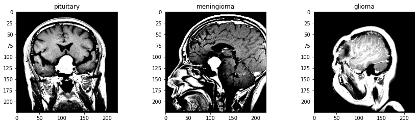
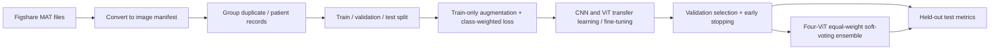

# Brain Tumor Classification: CNNs and Vision Transformers

A reproducible PyTorch comparative study of transfer learning and fine-tuning for three-class brain tumor MRI classification. The project benchmarks three CNNs against four Vision Transformers (ViTs), evaluates models with class-balanced metrics, and implements an equal-weight ViT soft-voting ensemble.

> **Research status (October 2026):** The three CNN validation selection scores below came from one Colab run. The runtime crashed before ViT training. No ViT result is reported as an experiment yet, and the reported CNN values are not held-out test scores. The full comparison is ready to complete when GPU/TPU access is available.



*Illustrative MRI slices from the original project assets; this is not a model prediction or an evaluation figure.*

## Study question

How do established CNN architectures and ImageNet-pretrained ViT architectures compare on the same Figshare brain tumor dataset when fine-tuned with a consistent, leakage-conscious split and selected using validation accuracy, macro precision, and macro recall?

### Models in the comparison

| Family | Models | Status |
|---|---|---|
| CNN | VGG16, MobileNetV2, EfficientNet-B3 | Trained once; validation selection scores recorded below. Held-out test evaluation still needs to be run. |
| ViT | ViT-B/16, ViT-B/32, ViT-L/16, ViT-L/32 | Configured; training pending. |
| Ensemble | Equal-weight soft voting across the four ViTs | Configured; requires all four trained checkpoints. |

MobileNetV2 is the specific torchvision model used for the “MobileNet” comparison. The CNN model shortlist is motivated by a published brain MRI CNN comparison that identifies EfficientNetB3 and MobileNet among its top performers and also reports VGG16 results. The published study's scores are literature context only; they are not substituted for this project's results. [CNN comparison paper](https://pmc.ncbi.nlm.nih.gov/articles/PMC10862681/)

## Current results

The score used for checkpoint selection is the unweighted average of validation accuracy, macro precision, and macro recall. Macro averaging weights the three classes equally, which is useful because Figshare's class counts are imbalanced. These values are **validation selection scores** (not accuracy percentages and not test-set results).

| Rank so far | CNN model | Best validation selection score | Training time | Checkpoint |
|---:|---|---:|---:|---|
| 1 | MobileNetV2 | 0.9907 | 473.5 s | `outputs/checkpoints/mobilenet_v2.pt` |
| 2 | EfficientNet-B3 | 0.9880 | 415.9 s | `outputs/checkpoints/efficientnet_b3.pt` |
| 3 | VGG16 | 0.9787 | 1,397.3 s | `outputs/checkpoints/vgg16.pt` |

These numbers describe the run as reported by the training process. The per-model validation accuracy, macro precision, and macro recall are stored in each checkpoint's `.history.json`; use those and the held-out test reports for a full comparison. A validation score must not be presented as test performance. Runtime is hardware-dependent and is included only as the reported Colab run time.

| ViT / ensemble | Project result |
|---|---|
| ViT-B/16 | Pending training and held-out evaluation |
| ViT-B/32 | Pending training and held-out evaluation |
| ViT-L/16 | Pending training and held-out evaluation |
| ViT-L/32 | Pending training and held-out evaluation |
| Four-model soft-voting ensemble | Pending four checkpoints and evaluation |

## Data and leakage controls

The study uses the [Figshare brain tumor dataset](https://figshare.com/articles/dataset/brain_tumor_dataset/1512427), containing 3,064 T1-weighted contrast-enhanced images labeled as meningioma (708), glioma (1,426), or pituitary tumor (930). Raw images are converted from the dataset's MATLAB `.mat` format to PNG and recorded in a manifest.

The earlier notebook had an important evaluation risk: it generated augmented images before splitting the dataset. A transformed copy could therefore land in a different split from its source image, making test results overly optimistic. It also split without subject grouping. Its historical metrics and plots are intentionally not presented here as evidence for the refactored models. The replacement Colab notebook follows the current pipeline.

The current preparation code splits before augmentation, then applies random augmentation only to the training dataset. It groups records by `cjdata.PID` when present and also groups byte-identical images. Validation and test transformations are deterministic. **Limitation:** exact-duplicate grouping is not a near-duplicate detector; if usable patient IDs are absent, this pipeline cannot guarantee subject-level independence.

## Method

1. Convert MAT files and prepare deterministic, class-aware train/validation/test manifests (80/10/10 target ratios at the independent group level).
2. Initialize CNNs and ViTs from ImageNet-pretrained weights; train the classification head and backbone end-to-end (the current configs do not use a frozen-backbone warm-up stage).
3. Use train-only image augmentation and inverse-frequency class-weighted cross-entropy.
4. Monitor validation accuracy, macro precision, and macro recall. Select checkpoints by their mean; use `ReduceLROnPlateau` and early stopping (patience 6 epochs).
5. Once training is complete, evaluate each selected checkpoint on the held-out test split and report accuracy, balanced accuracy, macro/weighted precision and recall, F1, confusion matrix, and per-class metrics.
6. Compare model selection with validation data only; use the test set for final reporting, not tuning.



This is a research comparison, not a medical diagnostic system. The selected hyperparameters are starting settings rather than the result of an exhaustive hyperparameter search.

## Run on Google Colab

The notebook [`How_to_train_using_Colab_GPU.ipynb`](How_to_train_using_Colab_GPU.ipynb) walks through cloning the repo, preparing Figshare data, saving checkpoints to Google Drive, training models one at a time, evaluating, and comparing results. Enable a GPU in **Runtime → Change runtime type**. The notebook is designed to preserve completed checkpoints if a Colab runtime disconnects.

For command-line use, install the requirements and place extracted Figshare MAT files in `data/raw/`:

```bash
python -m pip install -r requirements.txt
python -m scripts.prepare_data --source data/raw --output data/processed
python -m scripts.train --config configs/vgg16.yaml
python -m scripts.train --config configs/mobilenet_v2.yaml
python -m scripts.train --config configs/efficientnet_b3.yaml
python -m scripts.train --config configs/vit_b_16.yaml
python -m scripts.train --config configs/vit_b_32.yaml
python -m scripts.train --config configs/vit_l_16.yaml --batch-size 2
python -m scripts.train --config configs/vit_l_32.yaml --batch-size 2
```

After all training finishes, evaluate checkpoints, for example:

```bash
python -m scripts.evaluate --config configs/mobilenet_v2.yaml --checkpoint outputs/checkpoints/mobilenet_v2.pt --output outputs/reports/mobilenet_v2.json
python -m scripts.compare_models --output-dir outputs/reports/
```

Use `scripts.evaluate` for each checkpoint. The comparison script combines evaluation reports with validation histories; it does not train models or create missing results. The four ViTs must use the same input resolution to form an ensemble. `scripts.ensemble` implements the equal-weight mean of their softmax probabilities, following the ensemble approach described in the ViT brain tumor paper. This repository uses PyTorch/timm model implementations, while that paper uses its own data and framework setup; results are not directly comparable. [ViT ensemble paper](https://www.mdpi.com/1718-7729/29/10/590)

## Repository map

```text
configs/       Reproducible per-model YAML settings
scripts/       Data preparation, training, evaluation, ensemble, comparison CLIs
src/           Dataset, models, training, metrics, visualization
Images/        Illustrative source images
outputs/       Generated checkpoints, histories, reports, and figures (not committed)
```

## References

1. [Performance of convolutional neural networks for the classification of brain tumors using magnetic resonance imaging](https://pmc.ncbi.nlm.nih.gov/articles/PMC10862681/). Inspiration for the CNN model shortlist and comparative-study framing.
2. [Vision Transformer ensemble study for brain tumor classification](https://www.mdpi.com/1718-7729/29/10/590). Reference for the four ViT variants and equal-weight soft-voting idea.
3. [Figshare brain tumor dataset](https://figshare.com/articles/dataset/brain_tumor_dataset/1512427). Source data.
